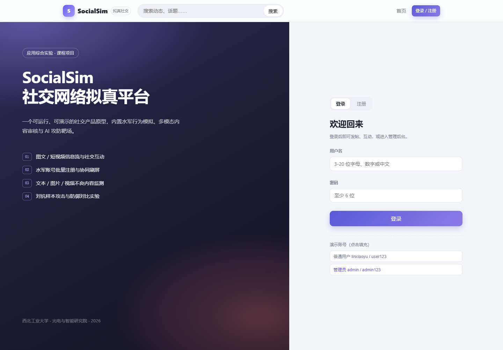
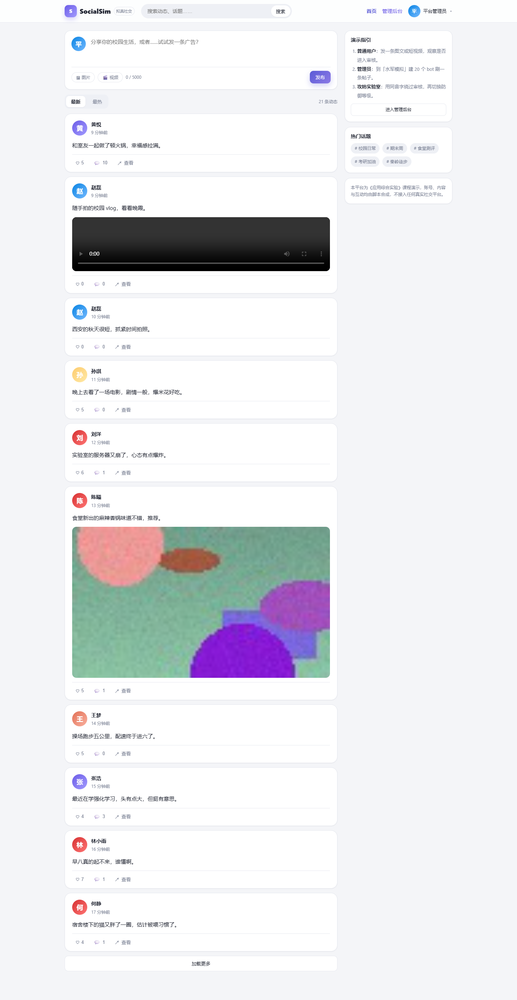
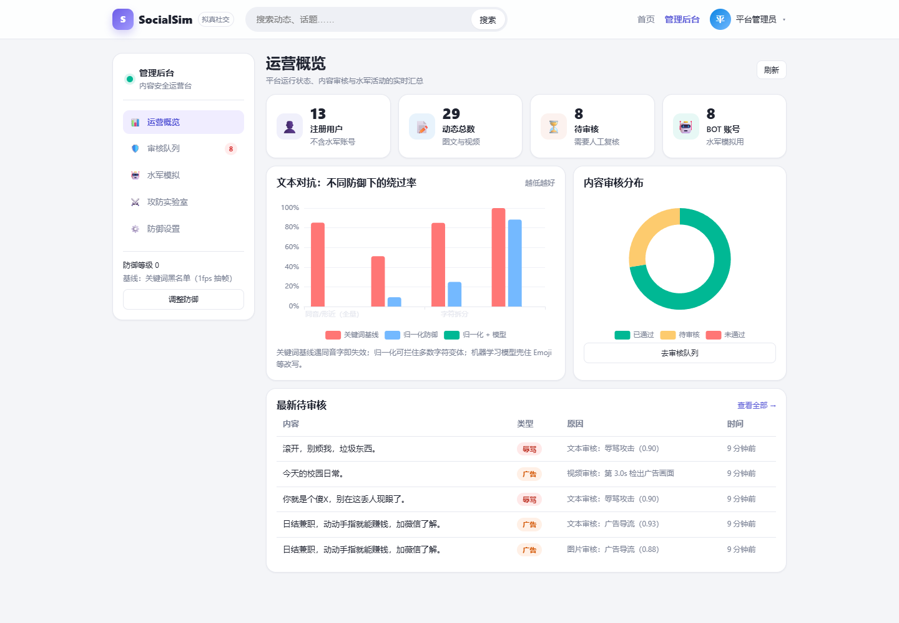
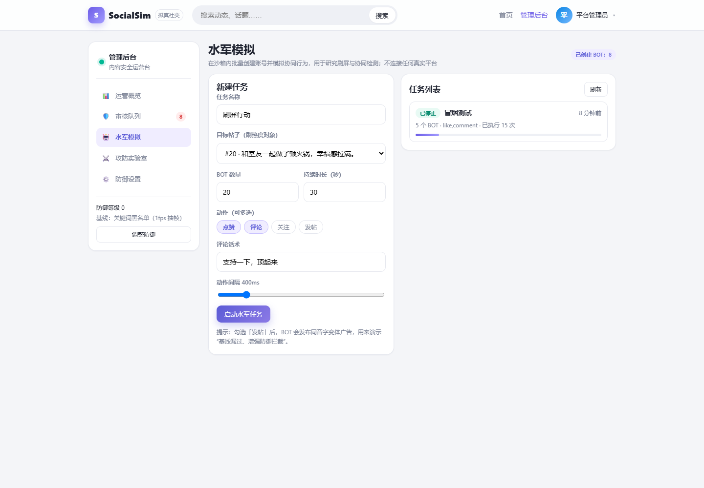
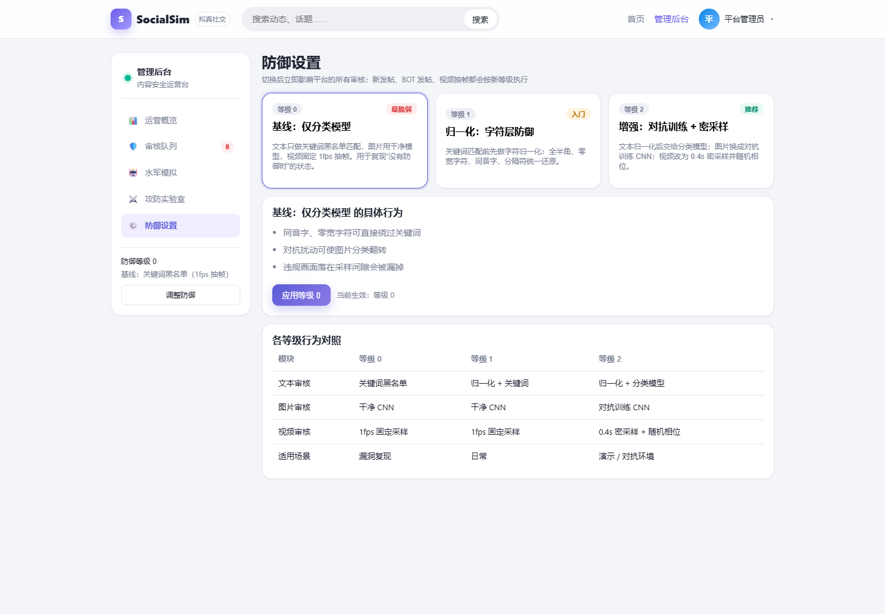

# SocialSim · 社交网络拟真平台

《应用综合实验》课程项目：一个**本地可运行、可演示**的社交网络原型，内置水军行为模拟、多模态内容审核，以及文本 / 图片 / 视频的 AI 攻防靶场。

- 所有账号、内容、互动均为脚本合成，**不连接任何真实社交平台**
- 一条命令启动，断网也能演示
- 代码、实验数据、截图、报告与答辩材料同仓管理



## 功能一览

| 模块 | 能力 |
|---|---|
| 社交平台 | 注册登录、图文/短视频发帖、信息流（最新/最热）、点赞、评论、关注、搜索、个人主页 |
| 水军模拟 | 批量创建 BOT、人设、点赞/评论/关注/发帖四种动作、任务编排、执行进度与时间曲线 |
| 内容审核 | 文本（关键词 → 归一化 → 分类模型）、图片（CNN 广告图识别）、视频（抽帧 + 时序聚合） |
| 审核运营 | 待审队列、模型初判理由与置信度、人工通过/驳回、处置留痕 |
| 攻防实验室 | 文本同音字/零宽/拆分/Emoji 变体；图片 PGD 对抗扰动；视频抽帧逃逸；三种防御强度对比 |
| 数据看板 | 用户/动态/待审/BOT 统计、绕过率对比、审核分布、任务执行曲线 |

<table>
<tr>
<td></td>
<td></td>
</tr>
<tr>
<td></td>
<td></td>
</tr>
</table>

## 快速开始

环境：Windows 10/11、Python 3.11+、Node.js 20（仅构建前端需要）。本机验证过 CPU 推理，无需 GPU。

```powershell
# 1. 安装依赖 + 生成数据 + 训练模型（首次约 5-10 分钟）
.\scripts\setup.ps1

# 2. 启动（自动打开浏览器）
.\scripts\run.ps1
# http://127.0.0.1:8000
```

已有环境时也可以手动启动：

```powershell
.\.venv\Scripts\python.exe -m uvicorn backend.app.main:app --port 8000
```

### 演示账号

| 角色 | 账号 | 密码 | 用途 |
|---|---|---|---|
| 管理员 | `admin` | `admin123` | 审核队列、水军任务、攻防实验室、防御设置 |
| 普通用户 | `linxiaoyu` | `user123` | 发帖、点赞、评论、关注 |
| 其他用户 | `zhanghao` / `wangmeng` / … | `user123` | 信息流互动 |

首次启动自动建库并灌入：12 个普通用户、8 个 BOT、29 条动态（含 8 条待审）、78 个点赞、26 条评论。

## 5 分钟演示脚本

1. **正常使用**（40s）：用 `linxiaoyu` 登录，发一条图文或短视频，刷新信息流，点赞、评论。
2. **水军刷屏**（60s）：用 `admin` 进入「水军模拟」，选一条帖子，20 个 BOT、点赞+评论、30 秒，启动；看任务进度、执行次数与时间曲线。
3. **审核拦截**（50s）：进入「审核队列」，展示模型初判理由（文本/图片/视频）、置信度，执行通过/驳回。
4. **攻击绕过**（70s）：进入「攻防实验室」：
   - 文本：同音字全量替换后，关键词基线漏过；切到归一化/模型后拦住；
   - 图片：加载示例广告图，PGD 扰动后分类器判为正常，但画面几乎不变；
   - 视频：1fps 采样漏掉 4.65s–4.95s 的广告画面，0.4s 密采样命中。
5. **防御升级**（50s）：到「防御设置」把等级从 0 切到 2，重跑攻击；回到看板展示绕过率下降。
6. **收尾**（20s）：一句话总结——平台是载体，攻防对比是重点。

## 系统结构

```
Vue3 + Vite + ECharts（单页应用，构建后由 FastAPI 托管）
                │ REST / JSON
FastAPI（JWT 鉴权、审核流水线、水军调度、攻防接口）
                │
SQLAlchemy + SQLite（业务数据、审核任务、实验记录）
                │
本地文件存储（图片/视频，/media 静态服务）
                │
scikit-learn 文本模型 ｜ PyTorch CNN 图像模型 ｜ OpenCV 抽帧
```

```
browser ──> FastAPI ──> SQLite
                │
                ├── text_mod: 归一化 → 关键词 / 分类模型
                ├── image_mod: CNN（干净 / 对抗训练）
                ├── video_mod: 抽帧 → 图像模型 → 时序聚合
                └── bot_engine: asyncio 调度 BOT 动作
```

## 技术选型

| 层 | 选型 | 说明 |
|---|---|---|
| 后端 | FastAPI + SQLAlchemy + SQLite | 单文件数据库，零运维，便于课程演示与迁移 |
| 前端 | Vue 3 + Vite + ECharts | 无 UI 框架依赖，构建产物约 1.2MB |
| 文本审核 | TF-IDF 字符 n-gram + LogisticRegression | 1080 条合成语料，CPU 秒级训练 |
| 图像审核 | 3 层 CNN（96×96） | 720 张合成广告图/正常图，CPU 训练约 2 分钟 |
| 视频审核 | OpenCV 抽帧 + 图像模型 | 支持 1fps / 0.4s 密采样与随机相位 |
| 攻防 | 字符变体、PGD、采样间隙 | 攻击与防御共用同一套数据与指标 |

> 说明：课程环境不依赖 HuggingFace 在线模型，全部模型本地训练、本地推理，保证断网可复现；后续可将文本模型替换为中文 RoBERTa、图像模型替换为 CLIP/ViT。

## 实验结果

数据均为本地脚本生成并实际跑出，位于 `ml/weights/*_metrics.json`。

### 文本审核（测试集 270 条）

| 方案 | 准确率 |
|---|---|
| 关键词基线（不归一化） | 83.3% |
| 归一化 + 关键词 | 93.7% |
| 归一化 + 分类模型 | **100%** |

对抗变体绕过率（越低越好）：

| 变体类型 | 关键词基线 | 归一化 | 归一化 + 模型 |
|---|---|---|---|
| 同音/形近（全量替换） | 85.2% | 0.0% | 0.0% |
| 零宽字符 | 51.7% | 9.4% | 0.0% |
| 字符拆分 | 85.0% | 25.0% | 0.0% |
| Emoji 插入 | 100.0% | 88.3% | 0.0% |

### 图片审核（测试集 180 张，PGD ε=24/255，20 步）

| 模型 | 干净准确率 | 攻击成功率 |
|---|---|---|
| 干净 CNN | 100% | 50.0% |
| 对抗训练 CNN | 100% | **3.3%** |

### 视频审核（8 秒演示视频，违规画面 0.3 秒）

| 策略 | 结果 |
|---|---|
| 固定 1fps | 漏过（违规落在 4.65s–4.95s 的采样间隙） |
| 1fps + 命中对照 | 检出（违规在 3.0s） |
| 0.4s 密采样 + 随机相位 | 检出率 72.5%（40 次试验） |

> 注意：以上为合成数据上的同分布测试，用于对比不同防御策略的相对变化，不代表真实平台效果。

## 仓库结构

```
backend/app/           FastAPI 应用（routers / services / models）
backend/tests/         pytest 单元测试（9 项）
ml/                    数据生成、训练、攻击、评测脚本；weights/ 为产出模型
frontend/              Vue3 单页应用
data/seed/             合成训练/测试数据
data/demo/             演示视频与示例图片
docs/                  截图、报告、答辩 PPT、演示脚本
scripts/               setup / run / build / dev / reset / smoke / ui_check
```

## 常用命令

```powershell
# 单元测试
.\.venv\Scripts\python.exe -m pytest backend/tests -q

# 端到端冒烟（需先启动后端）
.\.venv\Scripts\python.exe scripts\smoke.py

# 重新生成截图（需先启动后端）
.\.venv\Scripts\python.exe scripts\ui_check.py

# 重置演示数据
.\scripts\reset.ps1

# 前端开发模式（8000 + 5173）
.\scripts\dev.ps1
```

## 主要接口

| 方法 | 路径 | 说明 |
|---|---|---|
| POST | `/api/auth/register` / `/api/auth/login` | 注册 / 登录，返回 JWT |
| GET | `/api/posts?sort=hot&q=` | 信息流（最新/最热/搜索） |
| POST | `/api/posts` | 发帖（内容 + 已上传媒体 URL） |
| POST | `/api/upload` | 上传图片/短视频 |
| POST | `/api/posts/{id}/like` | 点赞 / 取消 |
| GET/POST | `/api/posts/{id}/comments` | 评论列表 / 发表评论 |
| GET | `/api/admin/stats` | 运营统计 |
| GET | `/api/admin/moderation` | 审核队列 |
| POST | `/api/admin/moderation/{id}/review` | 通过 / 驳回 |
| POST | `/api/admin/campaigns` | 创建水军任务 |
| GET | `/api/admin/campaigns/{id}` | 任务详情与曲线 |
| POST | `/api/admin/lab/text` | 文本攻防对比 |
| POST | `/api/admin/lab/image` | 图片 PGD 攻击 |
| POST | `/api/admin/lab/video` | 视频抽帧对比 |
| GET/PUT | `/api/admin/settings` | 防御等级 |

完整定义见启动后的 `/docs`（FastAPI Swagger UI）。

## 安全与伦理

- 平台仅运行在本机，账号、内容、互动全部由脚本合成；
- 「水军」功能用于研究协同行为与检测，不接入真实平台、不调用真实接口；
- 合成数据中不含真实个人隐私或真实不良素材，广告图/视频由 PIL/OpenCV 生成；
- 所有管理操作需管理员令牌，审核与处置留痕；
- 报告中单列「安全与伦理」一节说明边界。

## 已知限制

- 合成数据分布简单，指标偏乐观；真实场景需重新标注与训练；
- 文本模型为 TF-IDF + 线性分类器，语义泛化能力有限；
- 图像攻击只做数字域 PGD，未覆盖打印/拍摄等物理域；
- 视频为离线文件处理，未做实时流；
- SQLite 适合演示，不适合高并发。

## 课程交付物

| 交付物 | 位置 |
|---|---|
| 源代码 | 本仓库 |
| 实验报告 | `docs/报告-SocialSim.docx` |
| 答辩 PPT | `docs/答辩-SocialSim.pptx` |
| 演示脚本 | `docs/demo-script.md` |
| 演示视频 | 按 `docs/demo-script.md` 自行录屏（3–5 分钟） |

## License

课程作业用途。第三方依赖遵循各自开源协议。
