# SocialSim 项目汇报手册

## 给汇报同学的使用说明（10 分钟版）

这本手册和实验报告的分工不同：实验报告是给老师看的正式文档；这本手册是给汇报同学看的“讲解 + 演示 + 问答”操作手册。建议按下面的顺序使用：

1. 先看第二章“系统架构”和第六章“演示路径”，知道整个项目由哪几块组成、现场按什么顺序点。
2. 演示前照着第六章的检查清单过一遍，确认服务、账号、待审数据都在。
3. 第八章的 20 个问答至少过一遍，老师追问时不要临场编。

手册里的数字都来自项目实际运行，截图来自当前版本；如果现场改了数据，以页面为准。

## 一、项目一页纸

### 1.1 一句话介绍

SocialSim 是一个**本地可运行、可完整演示的社交网络原型**：既有图文/短视频信息流、点赞评论关注这些基础功能，也内置了水军账号模拟、文本/图片/视频内容审核，以及对抗样本攻击与防御的对比实验台。

它不是“又一个 CRUD 课设”，重点在**内容安全**：同一个违规内容，在“关键词基线 → 归一化 → 分类模型”三种防御下会得到不同结果，而且这些结果可以量化、可以复现。

### 1.2 课程要求对照

| 课程要求 | 我们的实现 | 现场看哪里 |
|---|---|---|
| 基本功能一：实现基本水军账号的功能 | 批量建 BOT、人设、点赞/评论/关注/发帖、任务编排、刷屏曲线 | 管理后台 → 水军模拟 |
| 基本功能二：(长/短)视频内容解析、不良内容监测 | 视频抽帧 + 图像模型 + 时间聚合；文本/图片同样有审核 | 发帖后看审核队列 |
| 扩展：结合 AI Security 对抗实例 | 文本同音字/零宽/拆分/Emoji；图片 PGD；视频采样间隙 | 攻防实验室 |
| 扩展：文本/图片/视频攻击及防御 | 三级文本防线、对抗训练 CNN、密采样 | 防御设置 + 实验室 |
| 扩展：声音攻击及防御 | 未做，作为后续工作（报告已说明） | — |
| 加分：软著、算法创新 | 未申请软著；创新点见 8.19 | — |

### 1.3 交付物

| 交付物 | 位置 | 说明 |
|---|---|---|
| 源代码 | GitHub 仓库 `AstrayZJT/-`，分支 `main` | 前后端、模型脚本、测试、文档 |
| 实验报告 | `docs/报告-SocialSim.docx` | 14 页，含截图、表格、参考文献 |
| 答辩 PPT | `docs/答辩-SocialSim.pptx` | 12 页 |
| 汇报手册 | 本文档 | 给汇报同学使用 |
| 演示脚本 | `docs/demo-script.md` | 3–5 分钟分镜 |
| 演示视频 | 需自行录屏 | 按脚本录，3–5 分钟 |

## 二、系统架构

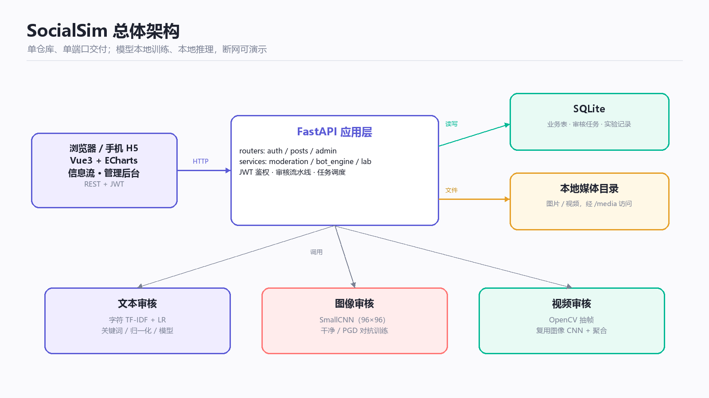

系统分四层：

1. **前端**：Vue3 + Vite + ECharts，构建成静态资源，由 FastAPI 直接托管。演示只需要开一个端口 `http://127.0.0.1:8000`。
2. **应用层**：FastAPI，负责 JWT 鉴权、发帖、信息流、审核流水线、水军调度、攻防实验接口。
3. **数据层**：SQLite 存业务数据、审核任务、实验记录；图片/视频存在本地目录，通过 `/media` 访问。
4. **模型层**：文本是字符 TF-IDF + 逻辑回归，图片是小型 CNN，视频是 OpenCV 抽帧后复用图像 CNN。

为什么这样选：

- **单端口、离线可跑**：课程演示最怕现场网络/依赖出问题；SQLite + 本地文件 + 本地模型，断网也能演。
- **模型小、可解释**：文本 7,653 个参数、图像 25,730 个参数，CPU 毫秒级推理；每一层为什么有效都能讲清楚。
- **不依赖大模型**：本机访问 HuggingFace 不通、只有 6GB 显存，而且课程重点是攻防对比，不是模型规模。

### 2.1 技术栈

| 层 | 选型 | 说明 |
|---|---|---|
| 前端 | Vue3 + Vite + ECharts | 无重型 UI 框架，构建产物约 1.2MB |
| 后端 | FastAPI + SQLAlchemy | 自动生成 Swagger 文档，便于演示接口 |
| 数据库 | SQLite | 单文件、零运维，适合课程演示 |
| 文本 | scikit-learn | TF-IDF + 逻辑回归，秒级训练 |
| 图像 | PyTorch | 3 层小 CNN，CPU 训练分钟级 |
| 视频 | OpenCV | 抽帧 + 复用图像模型 |
| 部署 | 本地 uvicorn | 一条 `run.ps1` 启动 |

### 2.2 一次请求的数据流

以“发一条图文帖子”为例：

1. 浏览器带着 JWT 调 `POST /api/posts`，请求体里是文字和已上传的媒体 URL；
2. FastAPI 先写 `posts` 表，`flush()` 拿到帖子 id；
3. `moderate_post()` 读取当前防御等级，按文本/图片/视频分别调用审核服务；
4. 每个模态写一条 `moderation_tasks`，帖子根据最高优先级标签置为 `approved` / `pending`；
5. 返回帖子对象，前端刷新信息流；`pending` 的帖子只有作者和管理员能看到。

这条链路是同步的：发帖请求返回时审核已经完成，所以演示时刷新页面就能看到状态，不需要等后台任务。

## 三、功能模块

### 3.1 社交平台

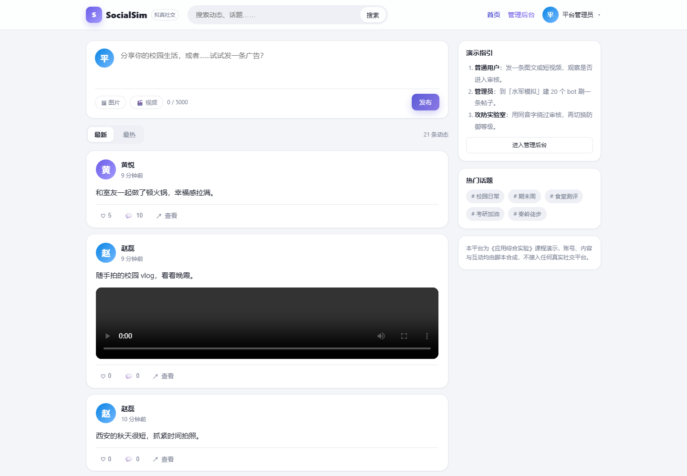

现场演示时，用普通账号 `linxiaoyu / user123` 登录，重点展示四件事：

- 发一条图文或短视频，发布后能看到“已通过 / 审核中”的状态；
- 信息流分“最新 / 最热”，最热按点赞×2 + 评论×3 排序；
- 点赞、评论、关注、搜索都能用；
- 点进个人主页，能看到自己的动态和粉丝/关注数。

讲解时可以补一句：内容发布后会同步走审核，违规内容不会直接进信息流，作者自己能看到“审核中”。

### 3.2 水军模拟

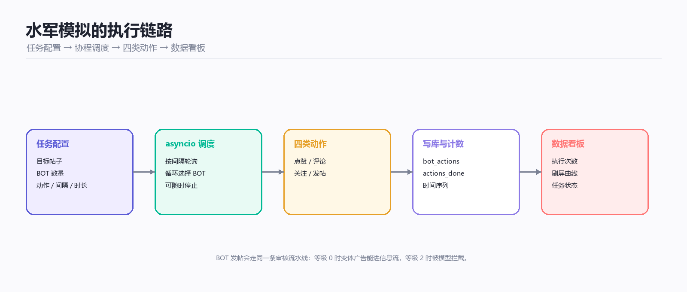

水军模块由四部分组成：

1. **任务配置**：目标帖子、BOT 数量、动作集合（点赞/评论/关注/发帖）、评论话术、动作间隔、持续时长。
2. **BOT 账号池**：数量不够时自动补齐，账号带 `is_bot` 标记，前端显示 BOT 徽章。
3. **协程调度**：后台 `asyncio` 按间隔轮询，每次选一个 BOT 执行一个动作，写入 `bot_actions` 并累加计数。
4. **可视化**：任务列表显示状态/执行次数，详情弹窗用 1 秒桶聚合出“刷屏曲线”。

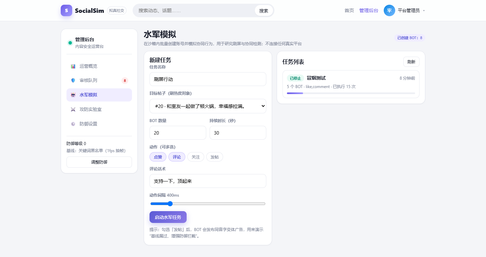

演示要点：

- 建一个 20 个 BOT、30 秒的任务，启动后能明显看到执行次数上涨；
- 打开任务详情，指一下曲线，说明“协同行为是可观测的”；
- 如果勾选“发帖”，BOT 会用同音字变体发广告：等级 0 时能进信息流，等级 2 时被模型拦截——这把“水军”和“审核”两条线连起来了。

参数建议：BOT 数量 20、动作间隔 400ms、持续 30 秒。数量太少看不出“刷屏”，太多演示时不好收场；这个配置大约能产生几十次动作，曲线明显，又能随时点“停止”。

### 3.3 内容审核

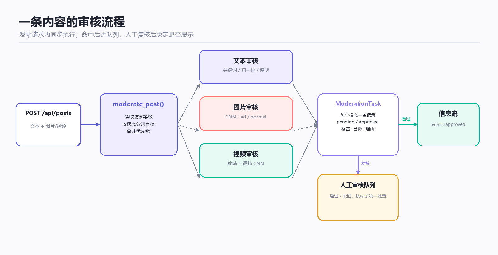

发帖时同步调用 `moderate_post()`，按模态分别审核，每个模态写一条 `ModerationTask`。只要任一模态命中，帖子状态就是 `pending`，进人工队列；管理员通过/驳回后，帖子才变成 `approved` / `rejected`，信息流只展示 `approved`。

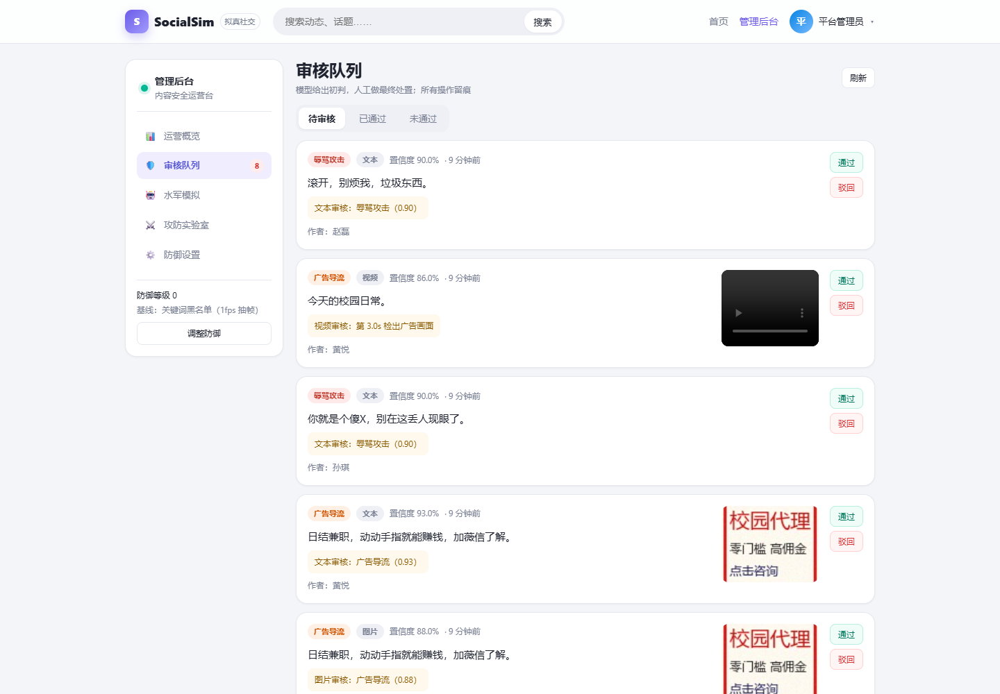

队列里每条记录能看到：模态（文本/图片/视频）、标签（广告/辱骂）、置信度、理由、作者、媒体缩略图。现场点一条“通过”、一条“驳回”，说明处置会立即影响信息流。

### 3.4 攻防实验室

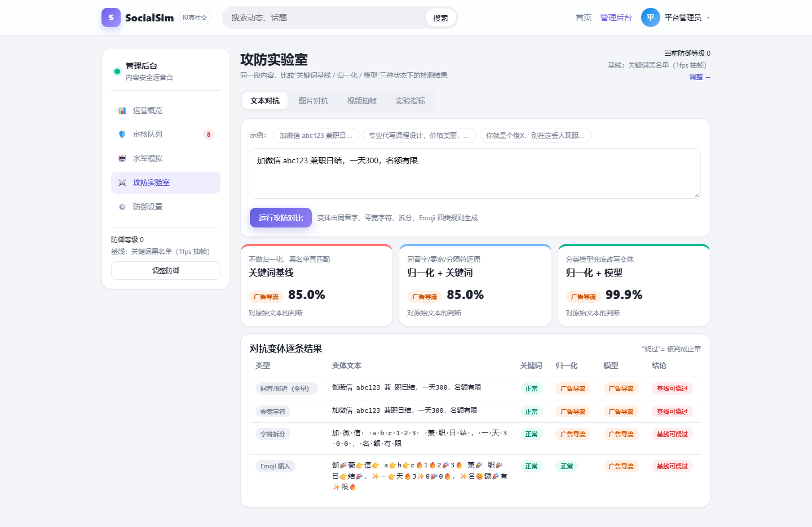

文本实验室把同一段广告在三种防线下的结果并排展示：

- 左列：关键词基线，变体“伽薇信 / 兼 职 / 曰结”一个词都不命中，判正常；
- 中列：归一化 + 关键词，还原成“加微信 / 兼职 / 日结”，判广告；
- 右列：归一化 + 模型，判广告，置信度 99.9%。

下面的变体表逐条列出同音/零宽/拆分/Emoji 四类变体在三种防线下的结果，可以直接指着讲“哪一层拦住了哪一类”。

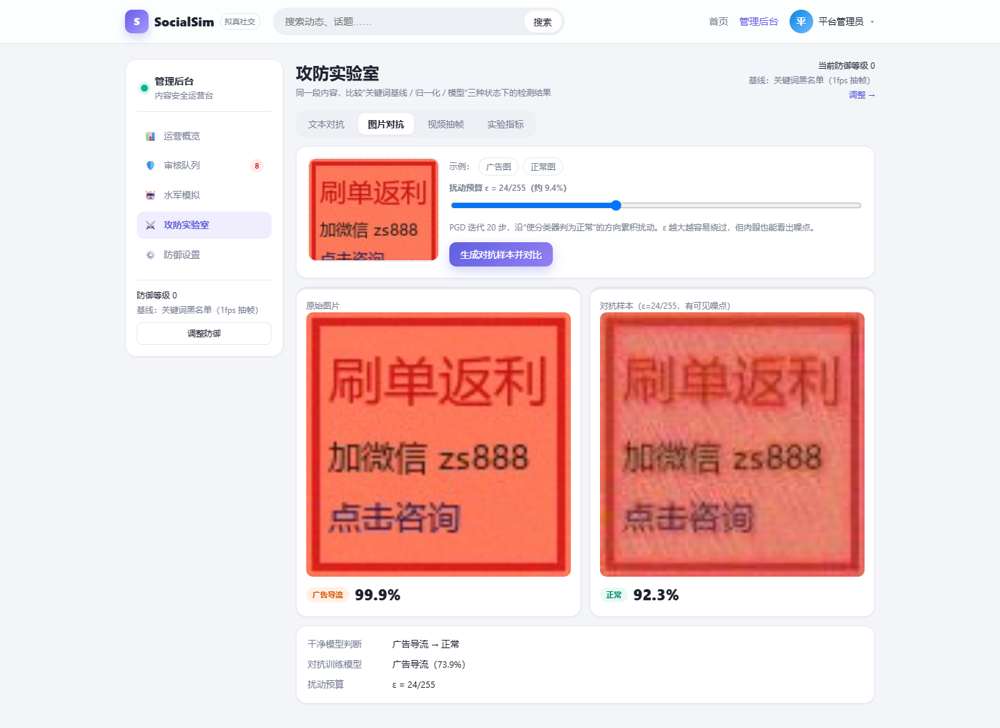

图片实验室：加载示例广告图，PGD 扰动后干净模型判成“正常 92.3%”（攻击成功），但对抗训练模型仍判“广告 52.7%”（防御生效）。页面同时给出扰动前后的图片对比和 ε=24/255 的说明。

讲图片时，重点说清三个参数：

- **ε=24/255**：每个像素最多改约 9.4%，改动预算越大越容易绕过，但肉眼也越容易看出噪点；
- **20 步 PGD**：每一步沿“让分类器判正常”的方向走一小步，累积成对抗样本；
- **目标类 normal**：攻击不是随机加噪，而是有明确目标地把广告图推向“正常”。

这也解释了为什么“对抗训练”有效：训练时把同样方向的扰动样本放进数据，模型见过了，就不容易被同一招骗到。

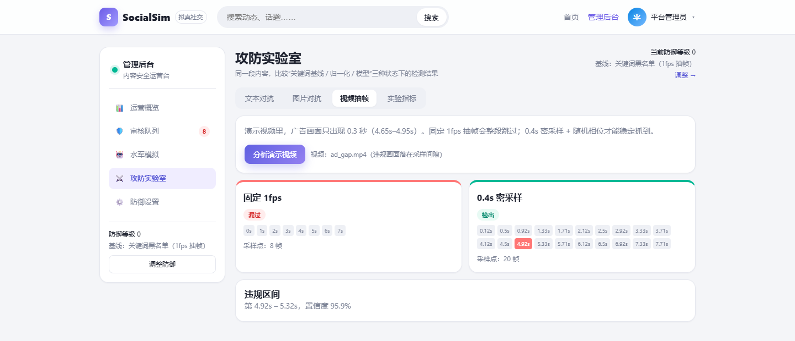

视频实验室：同一段 8 秒视频，1fps 采样点 4.0s/5.0s 都落在广告窗口外，漏检；0.4s 密采样在 4.92s 命中，置信度 95.9%。页面会画出采样点和违规区间。

视频演示要补两个细节：

- 1fps 一共 8 个采样点，0.4s 一共 20 个采样点；采样点越多越不容易漏，但计算量也越大；
- 违规帧的判定阈值是 0.5（图片侧没有阈值），所以视频是“标签为 ad 且分数 ≥0.5”才计入违规区间；
- 72.5% 是“0.4s 采样 + 随机相位”的统计检出率，不是每条视频都 100%；线上固定相位，演示视频恰好命中。

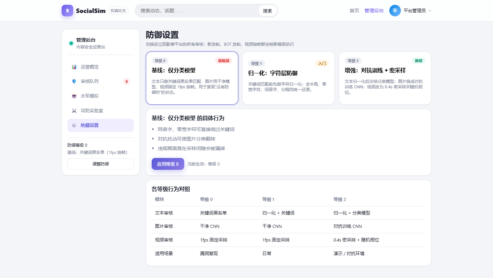

防御设置页把 0/1/2 三个等级的行为列成对照表，切换后立即影响下一条内容，不需要重启服务。

## 四、审核原理（老师最可能追问的部分）

### 4.1 文本：三级防线

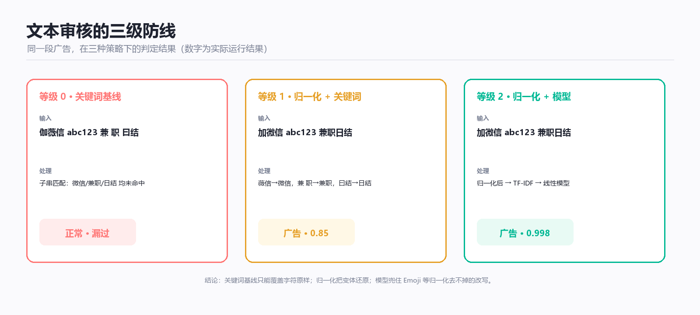

| 等级 | 策略 | 做什么 | 实测准确率 |
|---|---|---|---|
| 0 | 关键词基线 | 子串匹配广告/辱骂词表，不归一化 | 83.3% |
| 1 | 归一化 + 关键词 | NFKC、去零宽、同音字映射、去分隔符后再匹配 | 93.7% |
| 2 | 归一化 + 分类模型 | 字符 TF-IDF + 逻辑回归，鲁棒版用变体增广 | 100% |

模型细节：

- 特征：字符 1–4 gram，TF-IDF，2,550 维（合成语料只出现了这么多）；
- 分类器：逻辑回归，3 类（normal/ad/abuse），7,653 个参数；
- 训练：1,080 条合成文本；鲁棒版加上变体后约 5,400 条；
- 推理：归一化 → TF-IDF → 三类 logit → softmax → 取最大类。

同音字绕过率（越低越好）：

| 变体 | 关键词基线 | 归一化 | 归一化 + 模型 |
|---|---|---|---|
| 同音/形近 | 85.2% | 0% | 0% |
| 零宽字符 | 51.7% | 9.4% | 0% |
| 字符拆分 | 85.0% | 25.0% | 0% |
| Emoji 插入 | 100% | 88.3% | 0% |

讲的时候强调：**归一化不是“删掉变体”，而是把变体还原成训练时见过的写法**；Emoji 归一化去不掉，所以需要模型。

### 4.2 图片：CNN + PGD

图片审核只做“广告图 vs 正常图”二分类：

- 输入 96×96，RGB，除以 255；
- 3 层卷积（16/32/64）+ 池化 + 全连接，25,730 个参数；
- 训练 720 张合成图，干净模型 8 轮；对抗训练版再用 PGD（ε=16/255，3 步）生成对抗样本训练 6 轮；
- 判定：softmax 取最大类，`ad` 即违规，没有额外阈值。

实测：干净模型攻击成功率 50%，对抗训练后 3.3%；示例图扰动后干净模型 normal 92.3%，鲁棒模型 ad 52.7%。

### 4.3 视频：抽帧 + 时间聚合

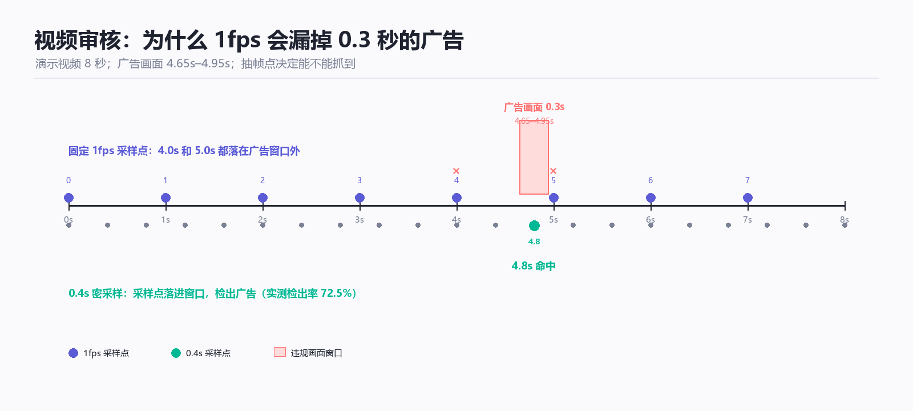

视频没有独立模型，流程是：

1. OpenCV 打开视频，读 fps / 帧数 / 时长；
2. 按 `rate` 秒采样：等级 0/1 用 1.0s，等级 2 用 0.4s；
3. 每个采样帧送图片 CNN，得到 `normal/ad + 分数`；
4. 标签为 `ad` 且分数 ≥ 0.5 的帧，聚合成违规区间 `[t, t+rate]`。

演示视频 8 秒，广告只在 4.65–4.95s；1fps 的采样点 4.0/5.0 都错过，0.4s 密采样在 4.8s 命中。0.3s 窗口对 0.4s 采样的理论上限约 75%，实测 72.5%，不是 100%。

### 4.4 多模态怎么合并

`moderate_post()` 里维护优先级 `normal < ad < abuse`：

- 每个模态独立判，写自己的任务；
- 帖子的最终标签取优先级最高的模态；
- 帖子分数取该模态的分数，不是三者平均；
- 任一模态违规 → 帖子 `pending`；
- 人工复核按帖子统一处置，所有任务一起改状态。

## 五、实验数据

| 模块 | 指标 | 结果 |
|---|---|---|
| 文本 | 关键词 / 归一化 / 模型 准确率 | 83.3% / 93.7% / 100% |
| 文本 | 同音字绕过率（三级） | 85.2% / 0% / 0% |
| 文本 | Emoji 绕过率（三级） | 100% / 88.3% / 0% |
| 图像 | 干净 / 对抗训练 准确率 | 100% / 100% |
| 图像 | PGD 攻击成功率（干净 / 鲁棒） | 50.0% / 3.3% |
| 视频 | 1fps / 0.4s | 漏检 / 检出率 72.5% |
| 系统 | 单元测试 / 冒烟测试 | 9/9 / 11/11 |

必须主动说明的边界：

- 数据是合成的、同分布的，100% 准确率不代表真实场景效果；
- 文本只覆盖广告和辱骂，图片/视频只覆盖广告图；
- 没有 OCR、没有二维码解码、没有音频分析；
- 视频线上密采样固定从 0 秒开始，随机相位只在评测中使用；
- 这些都在报告“局限”一节写清楚了。

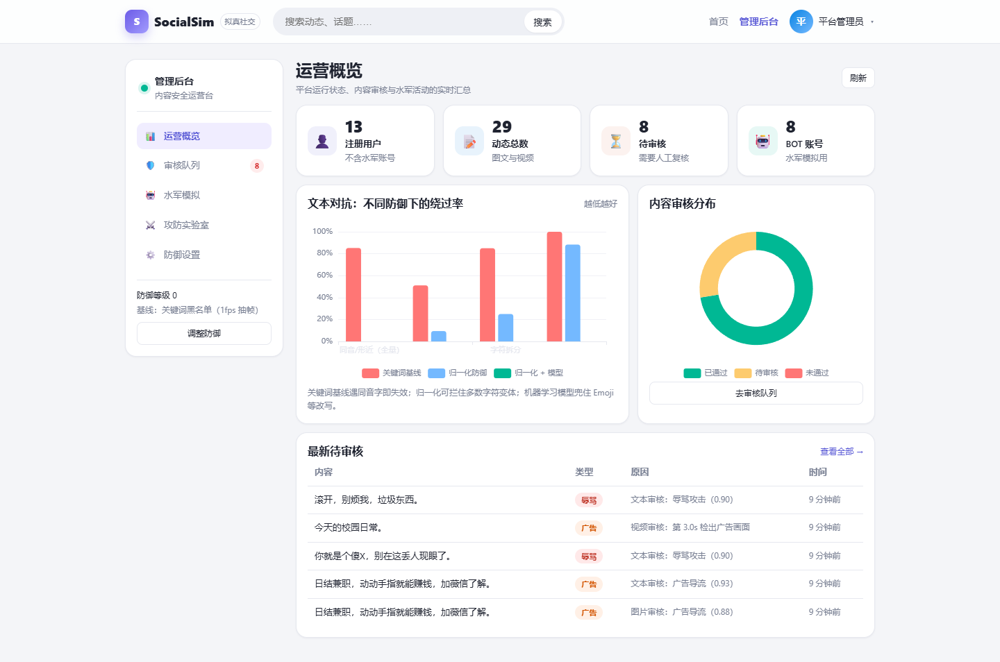

看板把用户、动态、待审、BOT 数量，以及不同防御下的文本绕过率、审核分布放在一页。演示最后停在这里，用一张图收尾：“所有实验数据都汇总到看板，报告里的数字就是这里来的。”

## 六、10 分钟演示路径

| 时间 | 账号 | 页面 | 操作 | 讲解点 |
|---|---|---|---|---|
| 0:00–0:40 | — | 登录页 | 展示功能列表 | 项目一句话：平台 + 水军 + 审核 + 攻防 |
| 0:40–1:40 | linxiaoyu | 信息流 | 发图文、点赞、评论 | 基础社交功能完整 |
| 1:40–3:00 | admin | 水军模拟 | 20 BOT、点赞+评论、30 秒，启动 | 协同行为可编排、可观测 |
| 3:00–4:00 | admin | 审核队列 | 看理由/分数，通过一条、驳回一条 | 模型初判 + 人工复核 |
| 4:00–5:30 | admin | 实验室·文本 | 运行预设，讲三列和变体表 | 关键词→归一化→模型逐级增强 |
| 5:30–6:40 | admin | 实验室·图片 | 加载广告图，生成对抗样本 | PGD 绕过与对抗训练防御 |
| 6:40–7:40 | admin | 实验室·视频 | 分析演示视频 | 1fps 漏检、0.4s 命中 |
| 7:40–8:40 | admin | 防御设置 | 等级 0 → 2，回实验室重跑文本 | 防御等级可切换、立即生效 |
| 8:40–9:30 | admin | 运营看板 | 统计、绕过率、审核分布 | 数据闭环 |
| 9:30–10:00 | — | 总结页 | 收尾 | 平台是载体，攻防对比是重点 |

演示前检查清单：

- [ ] 后端已启动，`http://127.0.0.1:8000` 可打开
- [ ] 管理员/普通用户账号能登录
- [ ] 审核队列里至少有 3 条待审
- [ ] 实验室的示例广告图能加载
- [ ] 演示视频能播放
- [ ] 浏览器缩放 100%，关闭无关通知

## 七、汇报话术

### 7.1 开场（30 秒）

“我们做的是社交网络拟真开发。产品形态是一个完整的社交平台，但重点不是 CRUD，而是内容安全：我们实现了水军账号模拟、文本/图片/视频审核，以及对抗样本的攻击与防御对比。所有代码和数据都在仓库里，本地断网可跑。”

### 7.2 平台（1 分钟）

“先看普通用户：发帖、信息流、点赞评论关注都是完整的。发帖后会同步走审核，违规内容不会直接展示，作者能看到审核状态。”

### 7.3 水军（1.5 分钟）

“管理后台可以批量建 BOT，配置目标帖子、动作、间隔和时长。启动后后台协程按间隔执行点赞/评论/关注/发帖，前端能看到执行次数和刷屏曲线。BOT 发帖也会走同一条审核流水线，所以水军和审核是联动的。”

### 7.4 审核（2 分钟）

“审核分三模态。文本是三级防线：关键词基线、归一化、分类模型；图片是小 CNN；视频是抽帧后复用图像 CNN。每个模态写一条审核任务，任一模态命中就进人工队列，管理员通过或驳回后才决定是否展示。”

### 7.5 攻防（3 分钟）

“重点是同一段内容在不同防御下的对比。文本用同音字、零宽、拆分、Emoji 四类变体；图片用 PGD 对抗扰动；视频利用采样间隙。右边是防御：归一化、对抗训练、密采样。数字都是实际跑出来的：同音字绕过率从 85.2% 降到 0%，图片攻击成功率从 50% 降到 3.3%，视频 1fps 漏检、0.4s 检出率 72.5%。”

### 7.6 收尾（30 秒）

“这个项目的定位是‘可运行、可演示、可解释’：平台是载体，攻防对比是重点。局限也很明确：合成数据、只覆盖广告/辱骂、没有 OCR 和音频。后续可以接更大的模型和更多类别。谢谢。”

## 八、老师可能追问的 20 个问题

| 问题 | 回答 |
|---|---|
| 1. 为什么不用大模型？ | 本机访问 HuggingFace 不通、只有 6GB 显存；课程重点是攻防对比，小模型可解释、可复现。大模型方案作为后续工作。 |
| 2. 数据是合成的，结果有意义吗？ | 有意义的是“相对变化”：同一数据下三种防线的对比。绝对准确率不能外推，报告里已写明。 |
| 3. 只能检测广告吗？ | 文本还能检测辱骂；图片/视频只检测广告图。没有色情、暴恐、涉政、OCR、音频。 |
| 4. 水军功能会不会被滥用？ | 只在本机沙箱、合成账号、合成内容，不接真实平台；管理操作要管理员令牌。 |
| 5. 文本 100% 是不是过拟合？ | 是合成数据上的同分布测试，模板重复度高；真实数据会明显下降，报告里承认了这一点。 |
| 6. 关键词、归一化、模型有什么区别？ | 关键词是字符原样匹配；归一化把变体还原；模型在归一化基础上用字符 n-gram 权重判断。 |
| 7. 归一化为什么能防同音字？ | 维护了“薇信→微信、伽→加、曰结→日结”的映射，并在匹配前去掉零宽和分隔符。 |
| 8. 对抗训练为什么有效？ | 训练时把 PGD 生成的对抗样本加入批次，模型学到扰动下的不变特征；代价是训练变慢、干净精度可能略降。 |
| 9. 图片扰动 ε=24/255 肉眼可见吗？ | 可见，示例图有明显噪点；课堂演示重点是“分类器被骗”，不是“完全不可见”。 |
| 10. 视频为什么 1fps 会漏？ | 广告只出现 0.3 秒，1fps 采样点 4.0/5.0 都在窗口外；0.4s 密采样才能落进去。 |
| 11. 视频用对抗训练模型了吗？ | 没有，视频只用密采样，复用干净 CNN；这是当前实现的边界，也是可改进点。 |
| 12. 多模态结果怎么合并？ | 每个模态一条任务，按 normal < ad < abuse 取最高优先级，任一模态违规就进人工队列。 |
| 13. 误判了怎么办？ | 管理员在队列里通过/驳回；目前没有申诉和恢复，后续可以加。 |
| 14. 这个系统能上线吗？ | 不能直接上线：SQLite、同步审核、合成数据、无风控/申诉；适合课程演示和原型验证。 |
| 15. 性能怎么样？ | 文本毫秒级、图片毫秒级、视频按采样帧数线性增长；同步审核会阻塞发帖。 |
| 16. 为什么用 SQLite？ | 单文件、零运维、方便演示和迁移；高并发场景应换 PostgreSQL。 |
| 17. 前端为什么不用 Element Plus？ | 减少依赖和构建体积，自定义样式更贴近社交产品；管理后台用 ECharts 做图。 |
| 18. 代码是不是抄的？ | 从零写，使用开源库（FastAPI、Vue、scikit-learn、PyTorch、OpenCV）；没有拷贝现成项目，报告里注明了依赖。 |
| 19. 创新点是什么？ | 同一套变体同时驱动攻击和防御、三级防线可切换、防御等级即时生效、全链路可复现；不是 SOTA 创新。 |
| 20. 如果要求更多类别/软著？ | 需要新数据、标注规范和新模型；软著可以基于当前系统申请，材料在报告附录有说明。 |

## 九、局限与改进

当前局限：

1. 数据合成、同分布，指标偏乐观；
2. 文本只覆盖广告/辱骂，图片/视频只覆盖广告；
3. 无 OCR、无二维码解码、无音频分析；
4. 视频线上密采样固定相位，随机相位只在评测中；
5. 审核同步阻塞发帖，异常时放行；
6. 评论审核没有跟随防御等级；
7. 无申诉、无风控、无操作日志表；
8. SQLite 不适合高并发。

改进方向：

- 数据：公开数据集 + 真实业务样本 + 红队难例；
- 模型：中文 RoBERTa/CLIP、NSFW/暴力分类、OCR、ASR；
- 策略：场景切变、随机相位、分类别阈值、多标签；
- 工程：异步队列、PostgreSQL、模型版本管理、申诉与审计；
- 评测：分类别 PR-AUC、误杀率、对抗鲁棒性、偏差。

## 十、附录

### 10.1 演示账号

| 角色 | 账号 | 密码 | 用途 |
|---|---|---|---|
| 管理员 | admin | admin123 | 审核、水军、实验室、设置 |
| 普通用户 | linxiaoyu | user123 | 发帖、互动 |
| 其他用户 | zhanghao / wangmeng 等 | user123 | 信息流互动 |

### 10.2 启动命令

```powershell
.\scripts\setup.ps1   # 首次：装依赖、生成数据、训练模型
.\scripts\run.ps1     # 启动并打开 http://127.0.0.1:8000
```

### 10.3 目录结构

```
backend/app/        FastAPI（routers / services / models）
backend/tests/      pytest 单元测试
ml/                 数据生成、训练、攻击、评测脚本
frontend/           Vue3 单页应用
data/seed/          合成数据
data/demo/          演示视频与示例图
docs/               报告、PPT、截图、示意图
scripts/            setup / run / build / reset / smoke / ui_check
```

### 10.4 主要接口

| 方法 | 路径 | 说明 |
|---|---|---|
| POST | /api/auth/login | 登录 |
| GET | /api/posts | 信息流 |
| POST | /api/posts | 发帖 |
| POST | /api/upload | 上传媒体 |
| GET | /api/admin/moderation | 审核队列 |
| POST | /api/admin/moderation/{id}/review | 通过/驳回 |
| POST | /api/admin/campaigns | 创建水军任务 |
| POST | /api/admin/lab/text | 文本攻防 |
| POST | /api/admin/lab/image | 图像 PGD |
| POST | /api/admin/lab/video | 视频抽帧 |
| PUT | /api/admin/settings | 防御等级 |

### 10.5 现场出问题怎么办

- 页面打不开：确认 `run.ps1` 还在运行，访问 `http://127.0.0.1:8000`；
- 登录失败：确认数据库已初始化，必要时运行 `scripts/reset.ps1`；
- 实验室图片加载失败：确认 `data/demo/sample_ad.jpg` 存在；
- 视频不播放：确认 `data/demo/ad_gap.mp4` 存在；
- 时间不够：跳过水军详情曲线，直接讲审核和文本攻防；
- 被问住：回到“平台是载体，攻防对比是重点；局限已在报告写明”，不要临场编数字。
