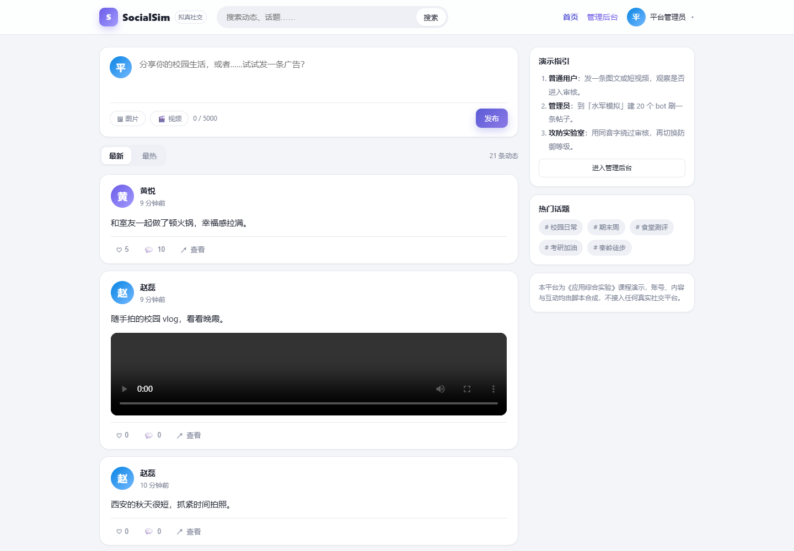
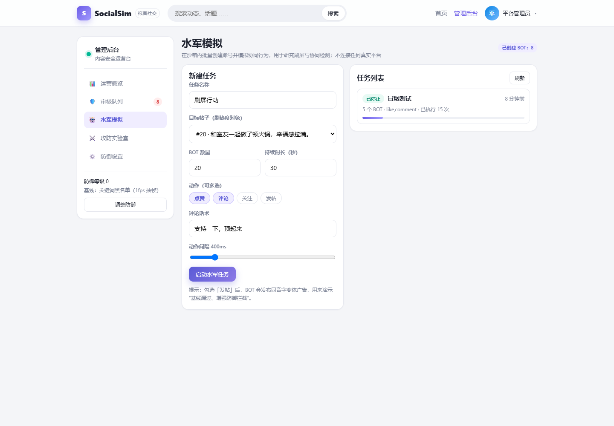
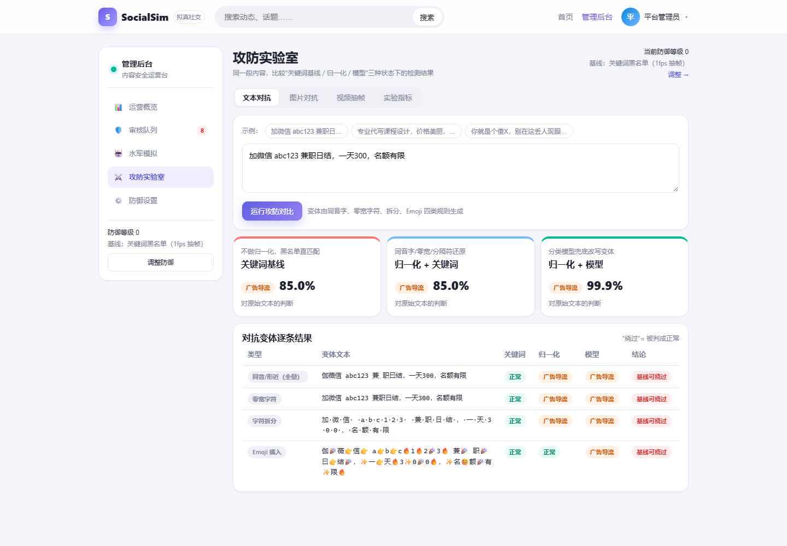
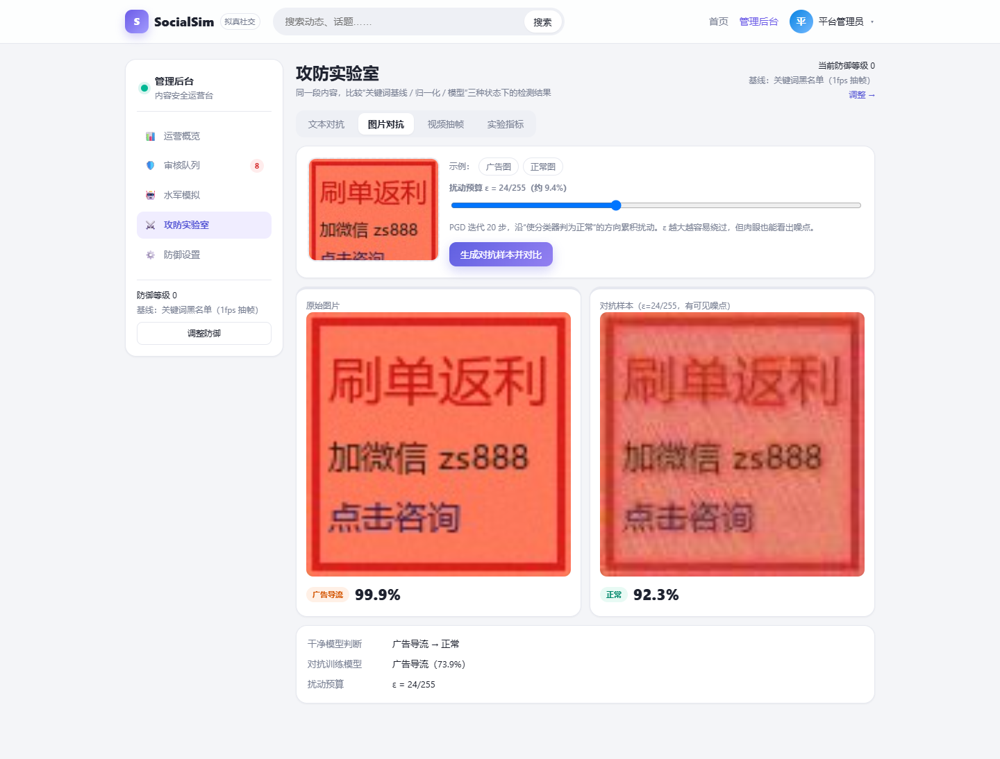
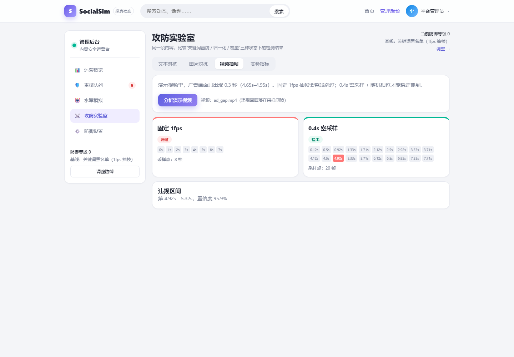

# SocialSim 社交网络拟真平台

## ——面向内容安全的社交网络模拟与 AI 攻防实验

课程名称：应用综合实验

题目：社交网络拟真开发

小组成员：________（学号：________）

小组成员：________（学号：________）

小组成员：________（学号：________）

指导教师：________

日期：2026 年 11 月

---

## 摘要

本项目面向《应用综合实验》"社交网络拟真开发"选题，实现了一个可在本机运行、可完整演示的社交网络原型 SocialSim。系统包含图文/短视频信息流、点赞评论关注等基础社交功能，并围绕课程 AI Security 主题实现了三部分能力：一是水军账号的批量创建与协同行为模拟；二是文本、图片、视频三类内容的不良信息监测；三是文本对抗变体、图像对抗扰动、视频抽帧逃逸三类攻击及对应防御的对比实验台。系统采用 FastAPI + SQLite + Vue3 实现，模型全部本地训练与推理，断网可复现。实验表明：关键词基线在 85.2% 的同音字变体上失效，归一化后可降至 0%；图像 PGD 攻击对干净 CNN 的成功率为 50%，对抗训练后降至 3.3%；固定 1fps 抽帧会漏掉 0.3 秒的瞬时违规画面，0.4 秒密采样可将其检出率提升到 72.5%。项目完成了课程要求的源代码、实验报告、答辩材料与演示脚本，并通过 9 项单元测试、11 项端到端冒烟测试和前端无报错检查。

**关键词**：社交网络；内容审核；对抗样本；水军检测；多模态

---

## 一、项目背景与需求

### 1.1 课程要求

课程要求以 3 人小组完成一个应用综合实验，交付源代码、实验报告、成果展示（PPT/路演）和小视频，严禁抄袭；申请软件著作权、做出算法创新可加分。可选题目中，"社交网络拟真开发"的基本功能是"实现基本水军账号的功能"与"(长/短)视频内容解析、不良内容监测"，扩展功能是"结合 AI Security 中阐述的对抗实例，增加部分功能""对文本、图片、视频等的攻击及防御"。

课程前半部分系统介绍了对抗样本、单像素攻击、物理对抗、语音对抗、推荐系统投毒等案例，其中"推荐系统共同访问图/促销攻击"与社交网络直接相关。课件中给出的参考项目"社交平台图像保护应用软件"（图像加载—编辑—对抗攻击—社交分享）说明，教师期望的是**能跑起来的产品原型 + AI 安全能力**，而不是纯调研。

### 1.2 选题理解

"拟真"在本项目中包含两层含义：产品形态拟真，即信息流、互动、审核后台的交互接近真实社交产品；运行环境受控，即所有账号、内容与互动均由脚本合成，系统不连接任何真实社交平台，避免把"水军功能"做成可被滥用的工具。这一边界既是课程作业的合规要求，也让实验可以反复复现。

### 1.3 功能需求

| 编号 | 需求 | 对应课程要求 |
|---|---|---|
| F1 | 注册登录、图文/短视频发帖、信息流、点赞评论关注、搜索 | 平台载体 |
| F2 | 批量创建 BOT，模拟点赞、评论、关注、发帖等协同行为 | 基本功能一 |
| F3 | 文本、图片、视频内容审核与人工复核队列 | 基本功能二 |
| F4 | 文本变体、图像对抗、视频抽帧三类攻击 | 扩展功能 |
| F5 | 归一化、对抗训练、密采样三类防御与量化对比 | 扩展功能 |
| F6 | 运营看板与任务执行曲线 | 展示需要 |

非目标：实时直播/IM、对接真实平台、推荐系统投毒、物理域对抗、软著与论文级创新。这些在"总结与改进"中作为后续工作讨论。

---

## 二、系统设计

### 2.1 总体架构

系统采用前后端分离、单端口交付的结构。前端使用 Vue3 + Vite 构建为静态资源，由 FastAPI 直接托管，演示时只需访问 `http://127.0.0.1:8000`。后端使用 FastAPI + SQLAlchemy + SQLite，媒体文件保存在本地目录并通过 `/media` 静态路由访问。模型推理与训练脚本放在 `ml/` 目录，后端以懒加载方式载入模型，缺少模型时自动退化为规则，保证系统始终可启动。

```
浏览器（Vue3）
   │ REST + JWT
FastAPI
   ├── auth / posts / users：社交业务
   ├── admin：审核队列、水军任务、攻防接口、防御等级
   ├── services/text_mod：归一化 + 关键词/分类模型
   ├── services/image_mod：CNN + PGD
   ├── services/video_mod：抽帧 + 图像模型
   └── services/bot_engine：asyncio 调度 BOT 动作
   │
SQLite + 本地媒体目录
```

### 2.2 数据模型

核心表包括：`users`（含 `is_admin`、`is_bot` 标记）、`posts`（内容、媒体、审核状态、置信度、点赞/评论计数）、`comments`、`likes`、`follows`、`moderation_tasks`（模态、标签、分数、理由、复核人）、`bot_campaigns`、`bot_actions`、`lab_runs`。审核任务与帖子一对多，一条帖子可能同时产生文本、图片、视频多条任务；人工复核以帖子为单位统一处置。

### 2.3 接口与鉴权

认证使用 JWT（HS256），密码使用 PBKDF2-SHA256 加盐存储。普通接口通过 `Authorization: Bearer` 识别用户，管理接口额外校验 `is_admin`。上传接口限制扩展名与大小（60MB），媒体路径经过规范化校验，防止目录穿越。主要接口包括 `/api/posts`、`/api/upload`、`/api/admin/moderation`、`/api/admin/campaigns`、`/api/admin/lab/*`、`/api/admin/settings`，完整列表见附录与 Swagger 文档。

### 2.4 前端设计

前端不使用重型 UI 框架，以自定义样式实现信息流、个人主页和管理后台三套布局。信息流采用双栏结构，左侧为发帖框与动态列表，右侧为演示指引与热门话题；管理后台采用侧边栏 + 内容区，包含运营概览、审核队列、水军模拟、攻防实验室、防御设置五个页面。图表使用 ECharts，数据来自后端统计接口与实验指标文件。



### 2.5 关键流程

发帖流程为：前端先调用上传接口拿到媒体 URL，再提交帖子；后端在同一请求内完成文本/图片/视频审核，写入审核任务并决定帖子状态；信息流查询只返回已通过的内容。这样做的优点是实现简单、状态一致，缺点是视频审核会阻塞发帖请求，后续应改为异步任务。

审核流程为：模型初判为违规的帖子进入 `pending`，并在 `moderation_tasks` 中按模态各记一条任务；管理员在队列中看到模态、标签、置信度和理由，执行通过或驳回后，帖子的状态与全部任务状态一起更新。同一帖子的多条任务以帖子为单位统一处置，避免"文本通过、图片驳回"的中间状态。

水军流程为：创建任务时补齐 BOT 账号并落库；后台协程按间隔轮询，每次选一个 BOT 执行一个动作，写入 `bot_actions` 并累加计数；前端轮询详情，用 1 秒桶聚合动作时间序列。任务可随时停止，停止后协程在下一轮循环退出。

---

## 三、关键实现

### 3.1 社交平台

发帖流程为"先上传媒体、再创建帖子"：`POST /api/upload` 返回媒体 URL，`POST /api/posts` 携带文本与媒体 URL。创建帖子时同步调用审核流水线，根据命中情况把帖子置为 `approved` 或 `pending`；信息流只展示 `approved` 内容，作者在详情页可以看到自己的待审/未通过状态。点赞采用唯一约束防止重复，评论在写入前做一次文本审核，命中则标记为 `rejected` 且不计数。

### 3.2 水军模拟引擎

水军任务由 `bot_campaigns` 描述：目标帖子、BOT 数量、动作集合、评论话术、动作间隔与持续时长。创建任务时若 BOT 数量不足会自动补齐账号；后台用 `asyncio` 启动一个协程，按间隔轮询执行点赞、评论、关注、发帖四类动作，每次动作写入 `bot_actions` 并累加任务计数。前端每 2.5 秒轮询任务详情，用 1 秒桶聚合动作时间序列，形成"刷屏曲线"。

为演示"水军使用变体话术规避审核"，BOT 发帖内容使用同音字变体（如"加薇信""曰结"）。在防御等级 0 时这些帖子会进入信息流，切到等级 2 后会被模型拦截，从而把"水军"和"攻防"两条线连起来。



四类动作的实现与计数影响如下：

| 动作 | 实现 | 计数影响 |
|---|---|---|
| 点赞 | 查唯一约束，未点赞则插入 | `like_count + 1` |
| 评论 | 插入评论并累加 | `comment_count + 1` |
| 关注 | 关注目标帖作者，去重 | 关注关系 +1 |
| 发帖 | 以 BOT 身份发布变体广告，走审核 | 新帖子，可能进入待审 |

其中"发帖"动作会把水军与审核连起来：BOT 使用同音字变体发广告，防御等级 0 时会进入信息流，等级 2 时被模型拦截。

### 3.3 文本审核：关键词、归一化与模型

文本侧实现了三级递进的方案，对应三种防御等级：

1. **关键词基线**：维护广告导流（微信、兼职、日结、刷单等）与辱骂攻击（傻、滚、垃圾等）两类词表，直接做子串匹配。它代表平台早期只有黑名单的状态，优点是零成本、可解释，缺点是遇到同音字、零宽字符、拆分即失效。
2. **归一化 + 关键词**：先做 NFKC 全半角归一、去除零宽字符（U+200B 等）、同音/形近字映射（薇信→微信、伽→加、曰结→日结）、去除汉字间分隔符、合并拉丁字母间空格，再做关键词匹配。归一化是成本最低、收益最直接的一层防御。
3. **归一化 + 分类模型**：使用字符级 TF-IDF（1–4 gram，40000 维）加 LogisticRegression，在 1080 条合成语料上训练；推理前先归一化，用于兜住 Emoji 插入等归一化处理不了的改写。

攻击侧与防御侧共用一张字符映射表，生成四类变体：同音/形近全量替换、零宽字符插入、字符拆分、Emoji 插入。这样"攻击成功率下降"确实来自防御机制，而不是两套无关的数据。



### 3.4 图像审核：CNN 与对抗训练

图像侧把"不良内容"具体化为"广告导流图"：合成数据中，正常图由渐变背景、随机几何图形和噪声构成；广告图由暖色背景、红色边框、"限时特价/加微信"等文字和二维码占位块构成。模型为 3 层卷积 + 全连接的小型 CNN，输入 96×96，在 720 张训练图上训练 8 轮，测试集 180 张。

攻击使用 PGD（ε=24/255，20 步），目标是把广告图判成正常。防御采用对抗训练：每轮对批次样本生成 PGD 扰动（ε=16/255，3 步），把原样本与对抗样本一起训练，得到鲁棒模型。前端实验室支持上传图片或一键加载"确定能被绕过"的示例广告图，展示攻击前后的分类结果与图片对比。



### 3.5 视频审核：抽帧策略

视频审核把视频按固定间隔抽帧，复用图像模型逐帧分类，再按时间聚合为违规区间。演示视频为 8 秒、24fps，广告画面只出现在 4.65s–4.95s（0.3 秒）。固定 1fps 的采样点为 0、1、…、7 秒，恰好跨过该区间，因此漏检；把采样间隔降为 0.4 秒并引入随机相位后，采样点可以落入区间，从而检出。该实验说明：视频审核的漏检不一定来自模型不准，也可能来自采样策略本身。



### 3.6 攻防实验室与防御等级

管理后台提供 0/1/2 三个防御等级，切换后立即影响新发帖、BOT 发帖与视频审核：等级 0 为关键词 + 干净 CNN + 1fps；等级 1 增加文本归一化；等级 2 使用归一化 + 分类模型、对抗训练 CNN、0.4 秒密采样。实验室页面把同一段文本/同一张图/同一段视频在三种状态下的结果并排展示，并读取训练脚本产出的指标文件，形成"攻击—防御—量化"的闭环。

---

## 四、实验与结果

### 4.1 实验设置

- 文本：合成语料 1350 条，按类别分层 80%/20% 切分，训练 1080 条、测试 270 条；类别为正常、广告导流、辱骂攻击。
- 图像：训练 720 张、测试 180 张，类别为正常、广告导流；图像尺寸 96×96。
- 视频：8 秒、24fps 的合成视频 3 段（漏检演示、命中对照、正常对照）。
- 环境：Windows 11、Python 3.12、CPU 推理（Intel/AMD 笔记本），未使用 GPU。
- 指标：准确率、宏平均 F1、攻击成功率/绕过率、检出率。

### 4.2 文本审核结果

| 方案 | 测试准确率 |
|---|---|
| 关键词基线 | 83.3% |
| 归一化 + 关键词 | 93.7% |
| 归一化 + 分类模型 | 100% |

对抗变体绕过率（对违规样本生成变体，统计被判为正常的比例）：

| 变体类型 | 样本数 | 关键词基线 | 归一化 | 归一化 + 模型 |
|---|---|---|---|---|
| 同音/形近（全量替换） | 142 | 85.2% | 0.0% | 0.0% |
| 零宽字符 | 180 | 51.7% | 9.4% | 0.0% |
| 字符拆分 | 180 | 85.0% | 25.0% | 0.0% |
| Emoji 插入 | 180 | 100.0% | 88.3% | 0.0% |

可以看到：同音字对关键词基线几乎是"降维打击"，归一化后完全失效；零宽与拆分经归一化后仍有少量残余，主要来自归一化规则未覆盖的字符组合；分类模型对四类变体均能拦住。需要说明的是，测试集与训练集同分布，100% 的准确率偏乐观，真实场景需要更大规模、跨来源的数据。

### 4.3 图像审核结果

| 模型 | 干净准确率 | PGD 攻击成功率 |
|---|---|---|
| 干净 CNN | 100% | 50.0% |
| 对抗训练 CNN | 100% | 3.3% |

攻击成功率的定义为：广告测试图中，被 PGD 扰动后被判为正常的比例。干净模型有一半样本可以被翻转，说明小模型对像素级扰动并不鲁棒；对抗训练后攻击成功率降到 3.3%，且干净准确率没有下降。由于合成数据区分度较高，干净准确率饱和在 100%，这也意味着该数字不能直接外推到真实广告图。

### 4.4 视频审核结果

| 策略 | 结果 |
|---|---|
| 固定 1fps，违规在 4.65–4.95s | 漏检 |
| 固定 1fps，违规在 3.0s（对照） | 检出 |
| 正常视频，1fps | 无误报 |
| 0.4s 密采样 + 随机相位（40 次） | 检出率 72.5% |

0.4 秒采样对 0.3 秒的违规窗口并非 100% 命中，理论上限约为 0.3/0.4=75%，实测 72.5% 与理论一致。这说明密采样只能降低漏检概率，若要稳定检出瞬时违规，还需要场景切变检测、关键帧抽取或视频级时序模型。

### 4.5 系统测试

单元测试共 9 项，覆盖归一化、变体生成、关键词判定、密码哈希与 JWT；端到端冒烟测试共 11 项，覆盖健康检查、登录、信息流、统计、审核队列、文本攻防、图像攻击、视频漏检/命中、水军任务。

| 编号 | 用例 | 预期 | 结果 |
|---|---|---|---|
| 1 | 健康检查 | 返回 ok | 通过 |
| 2 | 管理员登录 | 返回令牌且 is_admin=true | 通过 |
| 3 | 信息流 | 返回已通过帖子 | 通过 |
| 4 | 运营统计 | 帖子数、待审数大于 0 | 通过 |
| 5 | 审核队列 | 返回待审任务 | 通过 |
| 6 | 文本攻击 | 至少 2 个变体绕过关键词 | 通过 |
| 7 | 文本防御 | 归一化拦住全部已绕过变体 | 通过 |
| 8 | 图像攻击 | 广告图被判为正常 | 通过 |
| 9 | 视频 1fps | 漏检 4.65s 广告 | 通过 |
| 10 | 视频密采样 | 检出违规区间 | 通过 |
| 11 | 水军任务 | 执行次数大于 0 且有曲线 | 通过 |

前端检查使用 Playwright 驱动本机 Chrome 打开 8 个页面，控制台无 error，截图见 `docs/screenshots/`。以上测试均可通过 `scripts/smoke.py` 与 `pytest` 复现。

---

## 五、演示流程

演示按"正常使用—水军刷屏—审核拦截—攻击绕过—防御升级"五段组织，总时长约 5 分钟：

1. 普通用户登录，发布一条图文或短视频，刷新信息流并点赞评论；
2. 管理员创建 20 个 BOT 的任务，观察执行次数与刷屏曲线；
3. 打开审核队列，展示模型理由与置信度，执行通过/驳回；
4. 在实验室用同音字绕过关键词、用 PGD 翻转广告图、用 1fps 漏掉瞬时广告；
5. 把防御等级切到 2，重跑攻击，回到看板展示绕过率下降。

详细分镜与旁白见 `docs/demo-script.md`。

---

## 六、安全与伦理

本项目的"水军"能力仅用于研究协同行为与检测，系统不连接任何真实社交平台、不调用真实接口、不使用真实用户数据。所有账号由脚本生成，所有内容为模板合成，广告图与视频由 PIL/OpenCV 生成，不包含真实个人隐私或真实不良素材。管理操作需要管理员令牌，审核与处置有记录。报告与演示中明确标注"合成数据、沙箱环境"，避免被误解为可用的刷量工具。

---

## 七、总结与改进

项目完成了课程要求的两项基本功能与主要扩展功能，形成了"平台—水军—审核—攻防"的完整闭环，并给出了可复现的实验数字。主要不足与改进方向：

1. **数据规模与真实性**：合成数据分布简单，指标偏乐观；后续可引入公开中文有害文本数据集与真实广告图，做跨域测试。
2. **模型能力**：文本侧可替换为中文 RoBERTa 或小尺寸大模型，图像侧可替换为 CLIP/ViT，并比较微调与零样本的差异。
3. **攻击维度**：目前只做数字域 PGD，后续可加入对抗贴纸、图像篡改检测、语音对抗与推荐系统投毒。
4. **检测维度**：水军目前只有行为模拟，缺少协同检测算法；可加入时间同步、共同评论图、账号年龄等特征，做无监督异常检测。
5. **工程化**：SQLite 适合演示，后续可换 PostgreSQL，并把审核流水线改为消息队列，支持并发与重试。

---

## 参考文献

1. Goodfellow I J, Shlens J, Szegedy C. Explaining and harnessing adversarial examples[C]//ICLR. 2015.
2. Kurakin A, Goodfellow I, Bengio S. Adversarial examples in the physical world[C]//ICLR Workshop. 2017.
3. Su J, Vargas D V, Sakurai K. One pixel attack for fooling deep neural networks[J]. IEEE Transactions on Evolutionary Computation, 2019, 23(5): 828-841.
4. Finlayson S G, Chung H W, Kohane I S, et al. Adversarial attacks against medical deep learning systems[J]. arXiv:1804.05296, 2019.
5. Evtimov I, Eykholt K, Fernandes E, et al. Physical adversarial examples against deep neural networks[C]//USENIX Security Workshop. 2017.
6. Thys S, Van Ranst W, Goedemé T. Fooling automated surveillance cameras: adversarial patches to attack person detection[C]//CVPR Workshops. 2019.
7. Zhang G, Yan C, Ji X, et al. DolphinAttack: inaudible voice commands[C]//ACM CCS. 2017.
8. Yang G, Gong N Z, Cai Y. Fake co-visitation injection attacks to recommender systems[C]//NDSS. 2017.
9. Jia R, Liang P. Adversarial examples for evaluating reading comprehension systems[C]//EMNLP. 2017.
10. 西北工业大学光电与智能研究院. 应用综合实验课程课件[Z]. 2026.

---

## 附录 A 小组分工

| 成员 | 主要工作 |
|---|---|
| 成员 A | 后端平台、数据库、鉴权、部署与联调 |
| 成员 B | 前端页面、管理后台、可视化与演示录制 |
| 成员 C | 文本/图像/视频审核、攻防实验与指标评测 |

（请按实际分工填写。）

## 附录 B 运行说明

```powershell
.\scripts\setup.ps1   # 安装依赖、生成数据、训练模型
.\scripts\run.ps1     # 启动 http://127.0.0.1:8000
```

演示账号：管理员 `admin/admin123`，普通用户 `linxiaoyu/user123`。

## 附录 C 主要接口

| 方法 | 路径 | 说明 |
|---|---|---|
| POST | `/api/auth/login` | 登录 |
| GET | `/api/posts` | 信息流 |
| POST | `/api/posts` | 发帖 |
| POST | `/api/upload` | 上传媒体 |
| GET | `/api/admin/moderation` | 审核队列 |
| POST | `/api/admin/campaigns` | 创建水军任务 |
| POST | `/api/admin/lab/text` | 文本攻防 |
| POST | `/api/admin/lab/image` | 图像攻防 |
| POST | `/api/admin/lab/video` | 视频抽帧 |
| PUT | `/api/admin/settings` | 防御等级 |

## 附录 D 复现命令

```powershell
# 安装与训练
.\scripts\setup.ps1

# 单元测试
.\.venv\Scripts\python.exe -m pytest backend/tests -q

# 启动后端（另一个终端）
.\.venv\Scripts\python.exe -m uvicorn backend.app.main:app --port 8000

# 端到端冒烟
.\.venv\Scripts\python.exe scripts\smoke.py

# 重新生成报告与 PPT
.\.venv\Scripts\python.exe scripts\make_docs.py
```
